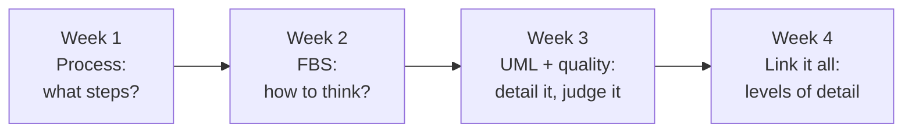
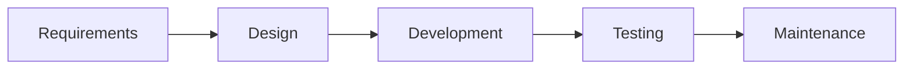
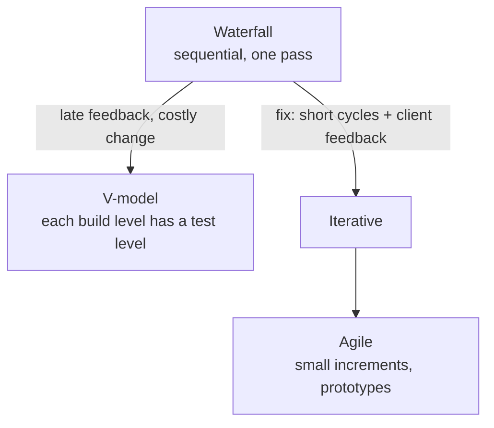
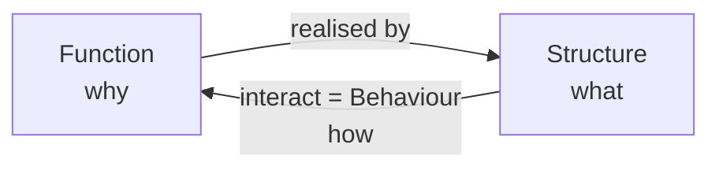
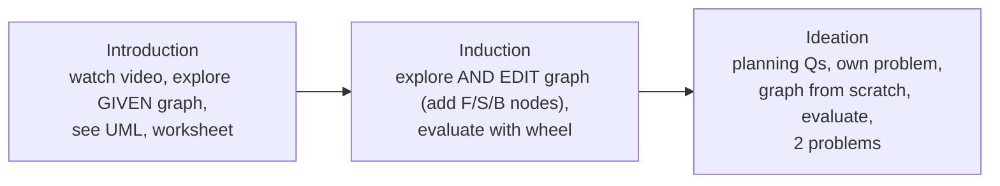
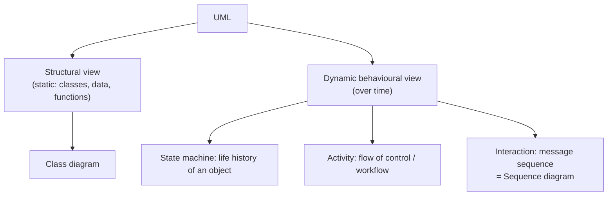
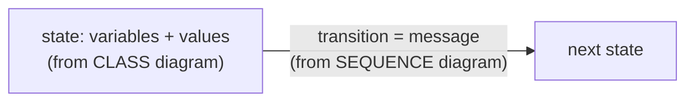
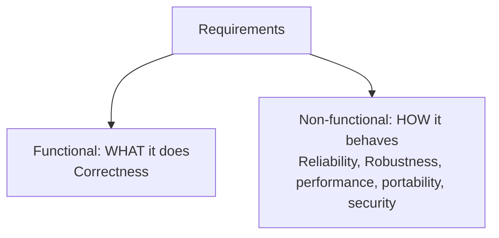
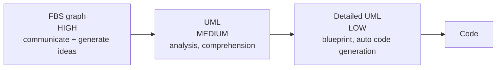

# Software Conceptual Design: the story in 4 weeks

One story: **you must build a feature (Amazon Pay, then a mood-based music player). How do you go from idea to working software?**

---

## Week 1: The process (what steps do we follow?)

### 1.1 Software = modules
Amazon is built from **modules** (separately addressable components, integrated to satisfy requirements).

| Component | What it does |
| --- | --- |
| **Inventory management** | measures **amount, location, pricing, mix** of products; home page updates with **purchasing, seasonal trends, demand** (logistics + analytics); page is **personalised** by items viewed + shopping history |
| **Payment gateway** | authorises electronic payments (net banking, debit cards...); **middleman between bank and merchant site**. Flow: site sends **encrypted card info** → gateway **confirms with the bank** → money moves from user to merchant |
| **Amazon Pay** | a **mobile wallet** (digital cash): link card/bank, categories (recharge, bills, travel, rewards, gift vouchers), **add money**, **auto reload** |

### 1.2 Five phases

**Requirements.** Goals the system must meet; they must cater to the clients. First step = understand the problem + study existing/similar systems (Paytm, PhonePe), **not** "learn a programming language". Think: **who** uses it, for **what**, in **what way**.

| Client type | Example |
| --- | --- |
| External user | mobile banking app serves bank customers |
| Internal to the company | employee resource portal built by an internal team with HR |
| Another software | Razorpay gateway between shop site and bank |

**Design.** Big-picture view; gives structure. Without it: developers have **different ideas** of how functionality works, change a function and **break a colleague's component**, delays, and **no overview to add new features**.

**Development.** Write code from requirements + design. **Distributed** (many places/time zones), tools like **Git/GitHub**, hence **documentation + precise interfaces**.
- **Interface** = *what* is accepted (inputs, format) and *what* is returned, **not how**. Example: inputs W, X, Y → output Z. **Code behind an interface can change** if the interface stays.

**Testing.** Check the software **behaves per requirements**; bugs still exist. Cost of bugs to the US economy: **~$59.5 billion (2002) → $1.1 trillion (2016)**.

| | Who | Where | Goal |
| --- | --- | --- | --- |
| **Alpha** | **internal employees** | **lab / staging** | catch as many issues as possible **before public release** |
| **Beta** | **actual users** | **real-life setting** | real-world feedback |

**Maintenance.** After release: **monitor** how users use it, **change code** for upgrades/fixes (missed conditions, browser-specific UI bugs), **add features**, plan the next release from feedback.

### 1.3 Development models

- **Waterfall:** phases strictly in sequence. Story: 2+3+4+3 = **12 months**, client sees it first at release: "I don't like it!". **Drawbacks:** (1) later change raises **cost and time**, (2) **clients don't know what they need**, (3) **designers don't know** which design is feasible/usable.
- **V-model:** waterfall **bent upward** after implementation. Left arm: concept → requirements/architecture → detailed design → **implementation** (bottom). Right arm: test/verify **individual modules** against design → verify/validate **whole system** against architecture → operation & maintenance.
- **Iterative:** many iterations: plan/build key features → deploy → **client feedback** → refine next iteration → repeat until complete.
- **Agile:** an iterative model; **small increments**, **prototypes** of key features released quickly. Frameworks: **Scrum, Kanban**. Practices: **sprints, test-driven development**. An **umbrella term / philosophy**, more than frameworks.
- Teams **choose and adapt** a model to their process and software type.

### 1.4 Software vs building (and car)
| | Building | Software |
| --- | --- | --- |
| Parts | **tangible** | **logical, abstract** |
| Change | hard | **adaptable**, anyone on the team can change it |
| Over time | **static** | **keeps changing** (Winamp → Saavn/Gaana) |
| Similar | blueprint first, requirement gathering, site visits / understanding end users, scale models | |

### MCQ rules, Week 1
- "NOT a phase" → **UI design**. Stage before development → **Design**.
- Internal colleagues test → **alpha**; real users → **beta**.
- "Gather info/regulations" → requirements · "modules + interaction" → design · "feedback + next release" → maintenance · "release to select users, find errors" → testing.
- Lab builds a model for itself → **internal** client.
- Interface → what, not how; code **can** change. Waterfall's drawback → **changing requirements**.

---

## Week 2: How to think about a design (FBS)

Phases and models don't say *how to think*. Experts use past systems as **reference points** and keep an **integrated view** asking **why, what, how**:

| | Asks | Is | Mood-player example |
| --- | --- | --- | --- |
| **Function (F)** | **Why** | **Features**, deliberated from requirements | mood detection, playlist creation, user authentication |
| **Structure (S)** | **What** | **Physical + logical components** that realise functions | emotion camera, playlist algorithm, emotion tagging of songs |
| **Behaviour (B)** | **How** | **Interaction between structures** that achieves the function | camera recognises emotion → gives it to playlist generator → playlist by mood |

**Mood player:** auto-detects mood, plays music by mood, secure authentication, remembers choices, recommends by mood + choice.

**Why integrate F, B, S?**
- Not integrated → **incoherent/incomplete design, many solutions, undecidable** (mood detection alone: webcam vs voice vs history).
- Integrated → (1) **unified view**, (2) **all requirements met**, (3) **team/stakeholder communication**, (4) **avoid getting stuck**.

**How to integrate (5 steps):** start from a **known solution** (e.g. existing mood cameras; check it fits) → think as **end user and system** to generate **behaviours** → **map** the structures working together in each behaviour → check how structures + behaviours **satisfy a requirement** → you now have F, B, S **identified and mapped**.

**FBS graph:** nodes = F/B/S (slides: F yellow, S blue, B red), links connect them, start from **any** node, **many valid graphs** (e.g. BSF, FSB), never one correct graph.

### Think & Link (tool to build + evaluate FBS graphs)
Pedagogical agent (prompts), notes box, tabs unlock as tasks complete.

**Introduction worksheet (6 tasks):** list F/S/B nodes · true/false with reasons · describe F, S, B in own words · list **connector types** (F-S, S-B ...) · examples of **pairs and trios** · write abstract sentences like "Function is implemented by Structure used during Behaviour".
**UML from FBS (component diagram):** one **component per structure node**; reflect **hierarchy** between structure nodes; check components that **implement no function**; every F-B-S link should have a matching interface.

**Evaluation wheel** (core: syntax, semantic, pragmatism). Each slice rated **Meets Expectation / Needs Improvement / Inadequate / Missing**, with a reason and planned changes. Can edit the graph and re-evaluate.

| Criterion | Means |
| --- | --- |
| **Complexity** | **number of nodes** in each of F, B, S |
| **Connectivity** | F, S, B nodes **interconnected** (linking purpose, concept, component, mechanism) |
| **Formal realisation** | graph **converts to UML diagrams** |
| Level adjacency, Validity, Consistency, Levels | on the wheel; **not defined in lectures** (only names appear) |

**Summary (L13):** conceptual design = a design description, **graphical, numerical or textual**; technique FBS, tool Think & Link.

### MCQ rules, Week 2
- No integration → **incoherent/redundant, multiple solutions**. Integration advantages → **all four**.
- How many graphs → **multiple**. Reason to link → **integrated solution**.
- Explore **then edit** → **Induction**. Build from scratch → **Ideation**.
- "Camera → playlist generator → playlist" = **interaction/behaviour** (and implementation of the feature), **not a use case**.
- Camera, algorithm = **structure**; "mood detection" = **function**; "user places face near camera" / "system fetches songs" = **behaviour**.
- Complexity = **count**; connectivity = **links**; formal realisation = **UML**.

---

## Week 3: Detail it in UML, then judge it

**Modelling** = creating an **external, explicit representation** of the system to be built. Benefits: plan what to code, **communicate to a larger team**, overview. FBS = **idea/concept**; UML = **more detail, multiple views**. (Example: one FBS function, mood detection, is expanded as a sequence diagram.)

Other UML diagrams exist (state chart, communication, use case, component, deployment...); a **subset** is used per design.

**Class diagram** (main building block of OO modelling): box with **3 compartments: name / attributes (data members) / operations (member functions)** + relationships. So it includes behaviour as operations. Mood player classes: User, User Voice Profile, Playlist, Song, User Mood (`moodName`, `detectMood()`). ATM: `balance` = data member, `setOption()` = member function.

**Sequence diagram:** objects from the class diagram on top, each with a **lifeline**; **horizontal arrows = messages in time order** (class-diagram functions such as `detectMood`, `generatePlaylist`). **One per requirement** (mood detection, login). Login has **alt/else**: valid → fetch profile/playlist → success; else → unsuccessful. For a check function returning false, read the **else message** ("Incorrect PIN").

### Understanding a design
**Design comprehension** = understanding a given design. Needed because developers work on **large existing systems** and add features (e.g. integrating the mood player into Amazon Music).

| Student difficulties | Expert knowledge (4 kinds) |
| --- | --- |
| (1) **notations** (syntax) | **Problem domain** (how a music player works) |
| (2) mapping **requirements ↔ design** | **Design diagram** knowledge (syntax + semantics) |
| (3) **connecting diagrams** (sequence uses class-diagram objects) | **Main goals** (purpose of each diagram; made of **sub-goals**: input, success, failure) |
| | **Dynamic behaviours** (how class **data members change** as the sequence runs) |

**VeriSIM = Verifying designs by Simulating scenarios**; gives an integrated understanding of **class + sequence** diagrams. Context: **automated door-locking system**: (1) if no passcode set, user **registers** one; (2) **lock** + correct passcode → locks, incorrect → **stays unlocked**; (3) **unlock** + correct → unlocks, incorrect → **stays locked**. Diagrams: class (Door, Controller, Passcode) + several sequence diagrams.

**Design tracing** = build a **state diagram for one scenario**:

e.g. start `lock=true`, E1 "set option unlock", E2 "enter correct passcode", E3 "door unlocks" → `lock=false`.

**VeriSIM stages:** Introduction (objectives) → **Problem understanding** (requirements + diagrams) → **Design tracing** (4 challenges, any order: **explore, correct, complete, construct the model**) → **Reflection**. Each activity has evaluation + reflection.

### Judging a design: quality (tiffin-service analogy)

| Attribute | Definition | Tiffin | App |
| --- | --- | --- | --- |
| **Correctness** | behaves **according to specification** (a **functional** requirement) | on time, no mix-up (breakfast for lunch) | all requirements satisfied (as in VeriSIM tracing) |
| **Reliability** | behaves the **same way over time** in the same environment | misses >3 meals a week | does **not crash often**; withdraw/deposit work |
| **Robustness** | **recovers from errors / unexpected input** | chef sick, replacement | **payment failure**, negative/large numbers, high traffic |

Checking reliability/robustness checks **how it behaves**, not the requirements. Quality attributes are **implicit, not in diagrams**, so **write them down** with the decisions based on them.

### MCQ rules, Week 3
- Two views → **structural + dynamic behavioural**. Design tracing → **state diagram of a scenario**; state variables ← **class**, transitions ← **sequence**.
- Functional = **features**; non-functional = **behaviour**.
- Handles failures/unexpected input → **robustness**; crashes often → **reliability**.
- "Class diagram only has data members" → **False**. `deposit()` returns → **True/False**.

---

## Week 4: Link it all (levels of detail)

**Recap:** week 1 modules (**modularization**) and phases; weeks 2-3 models. Development is a **systematic problem-solving process**, phases are broad and done **iteratively in many ways**. Software design is harder than architecture because software is **abstract and intangible**, though design processes are similar across domains.

**FBS definitions:** F = functionalities/features, **S = physical + logical components**, B = how structures interact.

**Mapping FBS to the process** (table from the Rational Unified Process): linking two FBS elements triggers a process.

| Link | Process initiated |
| --- | --- |
| **Function ↔ Behaviour** | **Requirement definition** |
| **Structure ↔ Behaviour** | **Design analysis**, testing, implementation, requirements change |
| **Behaviour ↔ Behaviour**, **Structure ↔ Structure** | **Evaluation, decomposition, refinement** |
| **Function ↔ Structure** | **Reusability and change in needs** |

**Abstraction** = hiding details at each stage of design; **level of detail = level of abstraction**.

FBS → UML: **functions → use cases**, **structures → class diagrams**, **behaviours → sequence diagrams**. Detailed UML ↔ code: **each model class maps to one or more code classes**; tools **auto-generate code**.

| Term | Meaning |
| --- | --- |
| **Modularization** | split into **independent co-working modules**, the system's **building blocks** |
| **Abstraction** | **hide details** at each design stage |
| **Decomposition** | **break down** implementation components |

**Experts** spend a lot of time **early**: understanding the problem, building models, **checking models in different scenarios**, before implementing. That is **software conceptual design**.

### MCQ rules, Week 4
- Structures in FBS → **physical and logical components**.
- Purposes of modelling (MSQ) → **communication/idea generation + analysis/comprehension + blueprint for implementation**; **not** "gather requirements from stakeholders".
- Communicate key ideas first → **FBS**; devs transform directly to code → **detailed UML**. FBS = **high-level overview**, UML = **more detailed**.
- Mapping questions: Function↔Behaviour = **requirements**; Structure↔Behaviour = **design analysis**; B↔B / S↔S = **evaluation/decomposition**; F↔S = **reusability**.
- Independent modules → modularization; hide details → abstraction; breaking components → decomposition.

---

## Last 10 minutes

1. Requirements → Design → Development → Testing → Maintenance. Clients: external / internal / software.
2. Alpha = internal + lab; Beta = real users. Waterfall problem = change. Agile = Scrum, Kanban, sprints, TDD.
3. Interface = what not how; code can change.
4. F = why/features, S = what/components, B = how/interactions. No integration → incoherent, many solutions.
5. Many FBS graphs. Induction edits, Ideation creates. Complexity = nodes, Connectivity = links, Formal realisation = UML.
6. UML: structural (class: name/attributes/operations) + dynamic (sequence: lifelines, messages). VeriSIM tracing = state diagram of a scenario.
7. Correctness (functional) · Reliability (crashes) · Robustness (failures, odd input).
8. FBS (high) → UML (medium) → detailed UML (low) → code. Modularization / abstraction / decomposition.
