# Software Conceptual Design — Complete Exam Notes

> NPTEL · IIT Bombay · Prof. Sridhar Iyer, Prof. Prajish Prasad, Prof. T. G. Lakshmi
> Covers all 4 weeks / 25 lectures of `Software conceptual design.pdf`, plus the 40 assignment questions (Weeks 1-4) with the traps they test.
> Slide images are taken straight from the course book. Practice questions: `practice/index.html`.

---

## 0. One-page cheat sheet (read this the night before)

**The whole course in 10 lines**

1. Big software (Amazon) = many **modules/components** (inventory management, payment gateway...) integrated to satisfy requirements.
2. **SDLC phases:** Requirements → Design → Development → Testing → Maintenance.
3. **Requirements** = goals the system must meet; they come from **clients**: external users, internal to the company, or **another software**.
4. **Design** = big-picture view; gives structure; avoids integration chaos; helps add features later. **Interface** = *what* a function does (inputs → outputs), not *how*; implementation can change if the interface stays.
5. **Testing:** alpha = internal employees, lab/staging; beta = real users, real-life setting. **Maintenance:** monitor use, fix, upgrade, add features.
6. **Models:** Waterfall (sequential; costly to change), V-model (verification and validation on the way up), Iterative / Agile (small increments, client feedback; Scrum, Kanban, sprints, TDD).
7. **Software vs building:** software is logical/abstract, adaptable, changes continuously. A building is tangible and static.
8. **FBS framework:** **F**unction = features (the *why*), **S**tructure = physical/logical components (the *what*), **B**ehaviour = interaction of structures that achieves the function (the *how*). Linked into an **FBS graph** (nodes F/B/S, links between them). Many valid graphs per problem. Tool: **Think & Link**.
9. **UML** = more detailed modelling. Two views: **Structural** (class diagram) and **Dynamic behavioural** (state machine, activity, interaction/sequence). **VeriSIM** = learning environment using **design tracing** (state diagram for one scenario). **Quality:** functional requirement = what it should do (correctness); non-functional = how it behaves (reliability, robustness, performance, portability, security).
10. **Abstraction levels:** FBS = high level → UML = medium → detailed UML = near code. **Modularization** splits system into modules; **abstraction** hides details; **decomposition** breaks implementation components down.

**Near-twins (the most common wrong answers)**

| This | Is NOT | Because |
| --- | --- | --- |
| Alpha testing | Beta testing | Alpha: internal employees, lab/staging. Beta: actual users, real-life setting |
| Reliability | Robustness | Reliability = behaves the *same way over time* (does not crash often). Robustness = *recovers from errors / unexpected input* (negative numbers, high traffic, failures) |
| Correctness | Reliability | Correctness = behaves according to its *specification* (a functional requirement) |
| Functional req. | Non-functional req. | Functional = *what* the system does (features). Non-functional = *how* it behaves (quality attributes) |
| Modularization | Decomposition | Modularization: split a system into independent co-working modules. Decomposition: breaking down the implementation components while creating a design |
| Modularization | Abstraction | Abstraction = hiding details at each stage of design |
| FBS graph | UML | FBS = high-level overview, communicate and generate ideas. UML = detailed, analysis, comprehension, blueprint for code |
| Complexity | Connectivity | Complexity = *number of nodes* per category (F, B, S). Connectivity = how the F, S, B nodes are *interconnected* |
| Structure (FBS) | Behaviour (FBS) | Structure = the components. Behaviour = the interaction among them |
| Class diagram | Sequence diagram | Class = static structure (classes, attributes, methods). Sequence = messages over time between objects (behaviour) |
| Requirements (phase) | Design (phase) | Requirements = goals. Design = big-picture structure that realises them |
| Design phase | Development phase | Design immediately precedes development in the traditional SDLC |

**Numbers and names to remember**

| Item | Value |
| --- | --- |
| Waterfall example timeline | 2 + 3 + 4 + 3 months = **12 months** before the client sees it |
| Cost of software bugs to the US economy | **2002: ~$59.5 billion** (≈ 60 B) → **2016: $1.1 trillion** |
| Running example (Week 1) | Amazon: inventory management system, payment gateway, Amazon Pay |
| Running example (Weeks 2-4) | Mood-based music player |
| VeriSIM example | Automated door-locking system |
| Think & Link phases | Introduction → Induction → Ideation (→ Iteration) |
| FBS evaluation wheel | Syntax / Semantic / Pragmatism core; Connectivity, Complexity, Level adjacency, Consistency, Validity, Formal realization, Levels |
| Non-software analogy used | Tiffin service (correctness, reliability, robustness) |

---

## 1. Course map

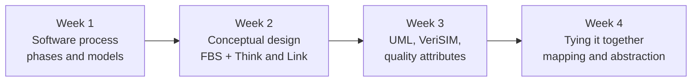

| Week | Lectures | Big idea |
| --- | --- | --- |
| 1 | 1-7 | How software is built: components, phases, development models |
| 2 | 8-13 | How to *think* about design: Function-Behaviour-Structure |
| 3 | 14-20 | Model the design in UML, comprehend it, evaluate it (quality) |
| 4 | 21-25 | Connect everything: FBS ↔ development process; levels of abstraction |

---

# WEEK 1 — Software Development Process

## Lecture 1: Deconstructing a software system

- We deconstruct an **e-commerce application** (Amazon) to see the software conceptual design process broadly.
- We look at the stages: **requirements specification, design (detailed design), development, testing and maintenance**. This gives the *big picture* of how software systems are built.

## Lecture 2: Thinking of software in terms of components

Amazon "seems to have everything and the process is effortless." How is such a system built? Out of **components**.

**Component 1: Inventory management system**

- Inventory management = the act of measuring the **amount, location, pricing and mix** of products available.
- The home page is updated based on **current purchasing, seasonal trends and fluctuating customer demand**. So **logistics and analytics** play a large part.
- The home page is **personalised**: it depends on the items you viewed and your shopping history.

**Component 2: Payment gateway**

- A service that **authorises electronic payments** (online banking, debit cards, cash cards...).
- It is a **middleman between the bank and the merchant's website/app**.
- Flow: the website sends **encrypted card information** to the gateway → the gateway confirms the validity with the **bank** → the required amount is transferred from the user's account to the merchant's account.

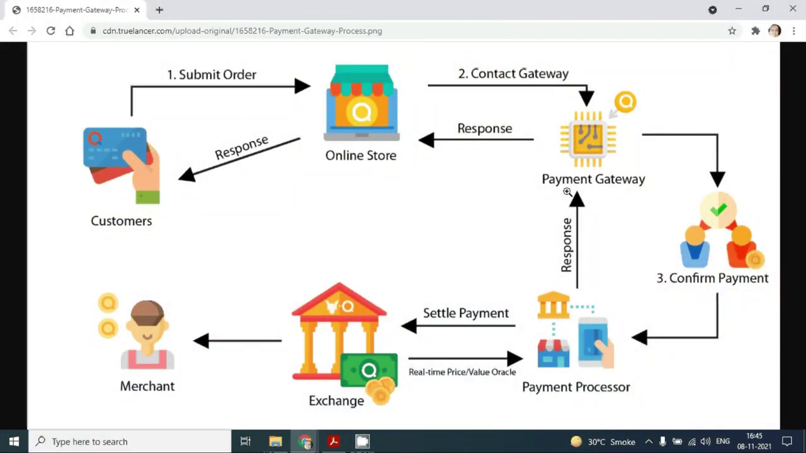

Other components of an e-commerce site: product catalogue and search, recommendations, shopping cart/orders, user accounts, delivery/logistics, reviews, etc. (the lecture asks you to list a few yourself).

**Key takeaway**
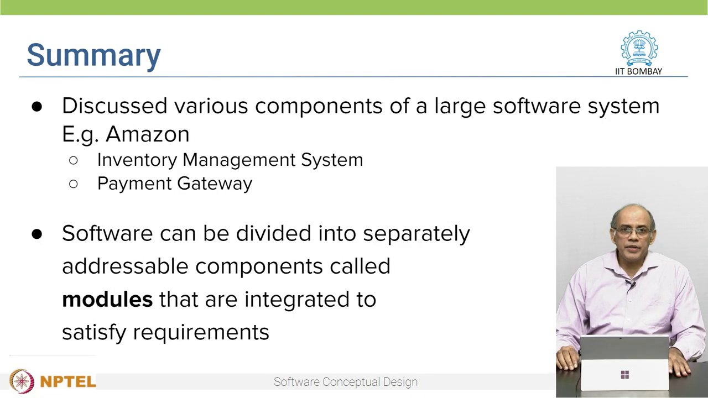

> **Software can be divided into separately addressable components called modules that are integrated to satisfy requirements.**

## Lecture 3: Requirement specification

**How did Amazon come up with Amazon Pay?** Amazon Pay is a **mobile wallet**: a way to carry cash in digital format. You link a credit/debit card or bank account, or transfer money online, and pay using your smartphone. It has categories (recharges, bill payments, travel and insurance, rewards, gift vouchers) and features like **add money** and **auto reload**.

**What is the first step in creating software?** (Reflection spot.)

- ✗ "Learn a programming language": true that you need code, but *before the solution you must know the problem to solve*.
- ✓ **Study existing systems and components** (how will a payment gateway interact with the software?).
- ✓ **Look at similar systems** (Paytm, PhonePe) to see how they implement features.

→ From this analysis you come up with an **explicit set of goals**. These goals are the **requirements**: *goals the implemented system should have; they should cater to the needs of the clients*. Requirement specification is the **first step in the software development process**.

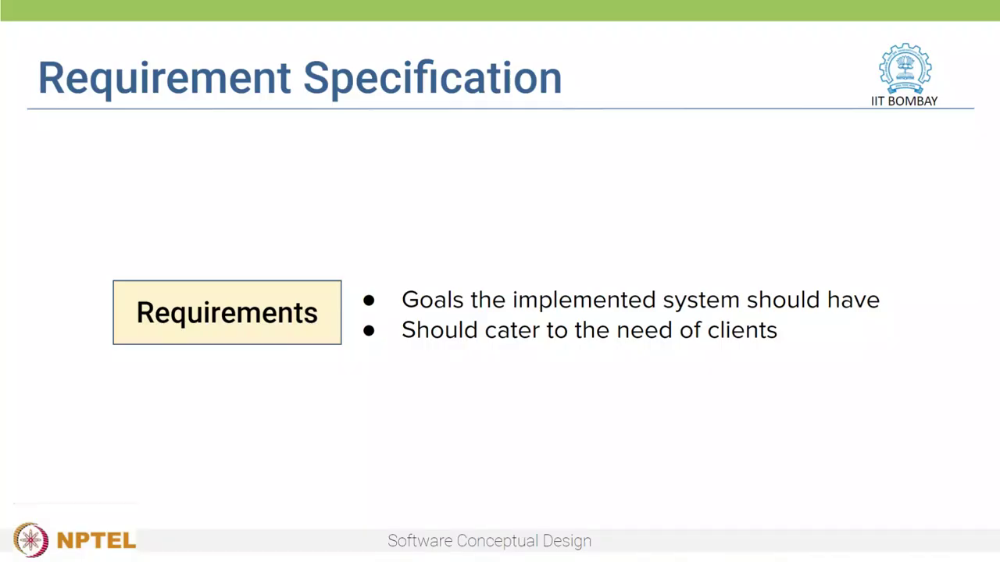

**Clients** = the people (or things) that use your software. A client need **not** be an end user:

| Client type | Example |
| --- | --- |
| **External user** (most typical) | Mobile banking software serves bank customers (check balance, transfer money) |
| **Internal to your company** | Employee resource portal; an internal products team talks to HR to understand requirements |
| **Another software** | Payment gateway (Razorpay) interfacing with an e-commerce site: site sends customer details, gateway talks to the bank, responds back (also refunds) |

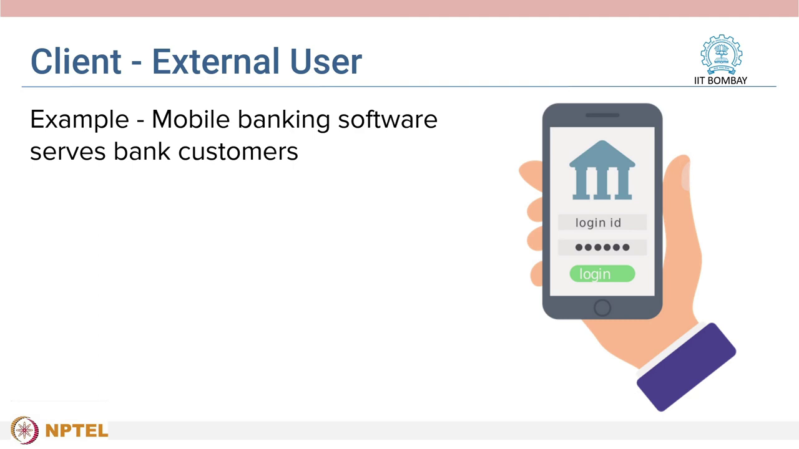
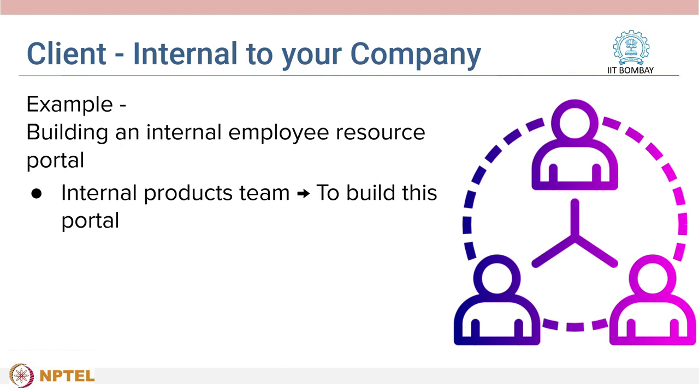
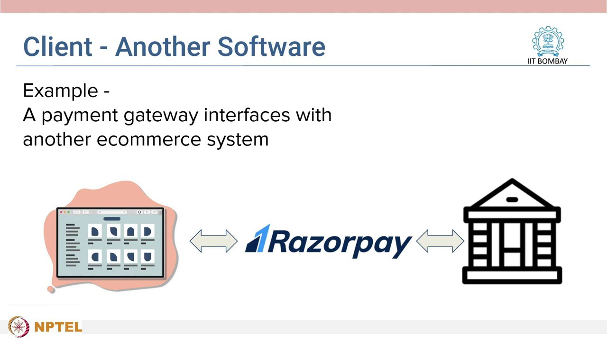

> Think about **who** is going to use your software, for **what purpose**, and in **what way**. The persona of the intended client must stay alive in your mind.

**Summary:** Requirement specification = first step. Clients = users of the software. Ensure the requirements capture the clients' needs.

## Lecture 4: Software design and development

**Why not jump into coding?** Imagine a small team implementing Amazon Pay straight from requirements:

- Different developers have **different ideas about how a functionality should be implemented**.
- A developer may change a function (e.g. add an argument) and break a colleague's component. Worse when components built by different people must **interact**.
- Product delayed, needlessly complicated.
- Adding a new feature later needs a **big-picture view** to decide how to integrate it.

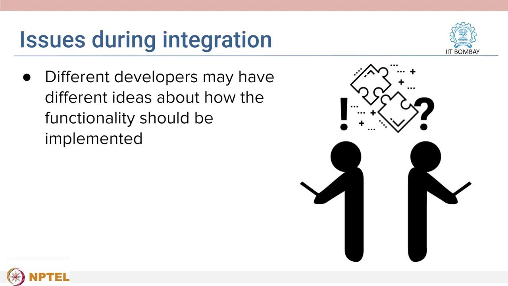
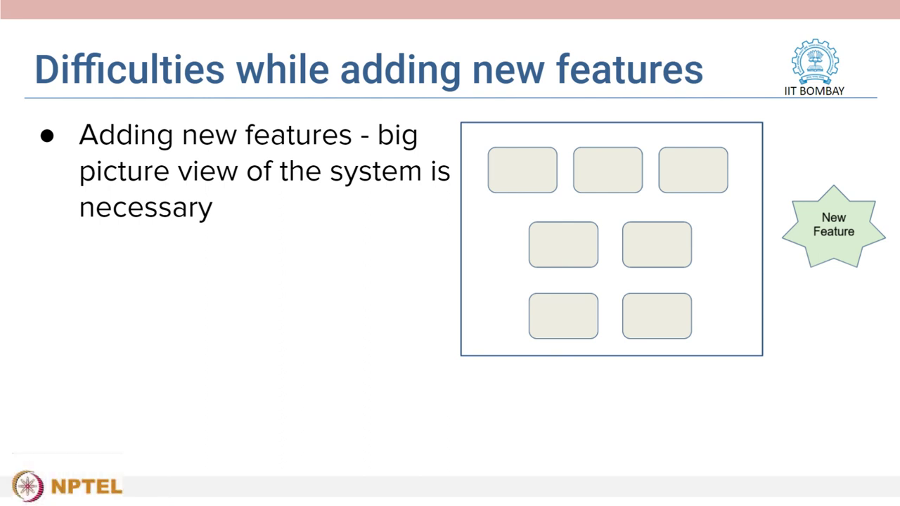

**Design phase** = the **big-picture view of the system**; it organises the code you will implement and **provides a structure to the software system**.

**Development phase**

- Multiple developers write the code for a feature, collaborating with tools like **GitHub / version control (Git)**.
- Development is **distributed**: different locations, even different time zones.
- So everyone needs a consistent understanding → developers write **documentation** and **precise interface definitions**.

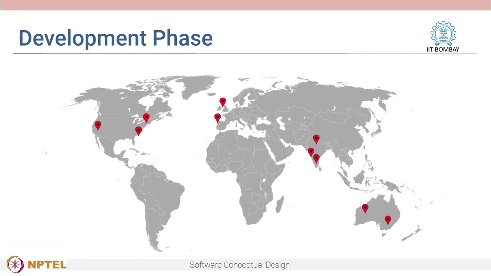

**Interface**

- The **description of the actions your functions can do without describing the implementation in detail**.
- Example: interface A takes 3 inputs (W, X, Y) and returns an output (Z). It shows *what requests are accepted in what format and the corresponding responses*.
- **The code implementing an interface can change as long as the interface remains the same.** (Assignment 1, Q8: the statement "the code cannot change once designed" is *false*.)

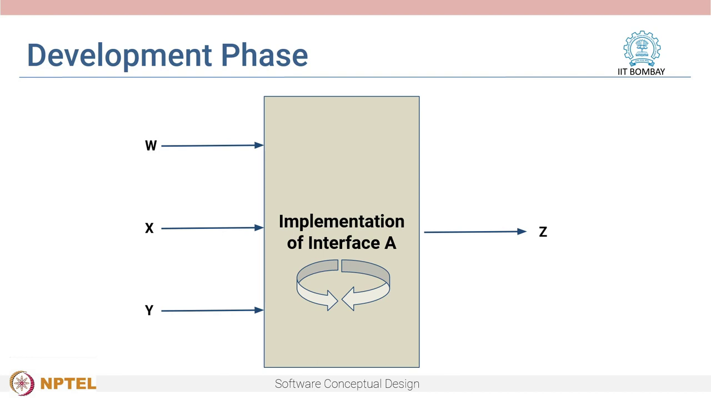

## Lecture 5: Software testing and maintenance

**Why test?** After the system is built it must **behave according to the requirements**. Many bugs/defects may still exist.

- Bugs cost the US economy about **$59.5 billion in 2002** and about **$1.1 trillion in 2016**.
- Failing to address even simple bugs can cause severe catastrophes.

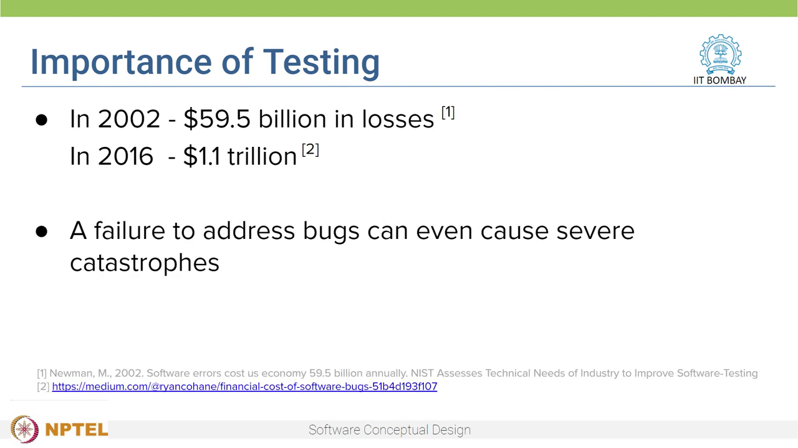

**Testing methodologies**

| | Who | Where | Goal |
| --- | --- | --- | --- |
| **Alpha testing** | **Internal employees** of the company | Lab / staging environment | Catch as many issues as possible **before the product is released to the public** |
| **Beta testing** | **Actual users** | **Real-life setting** | Real-world feedback after alpha |

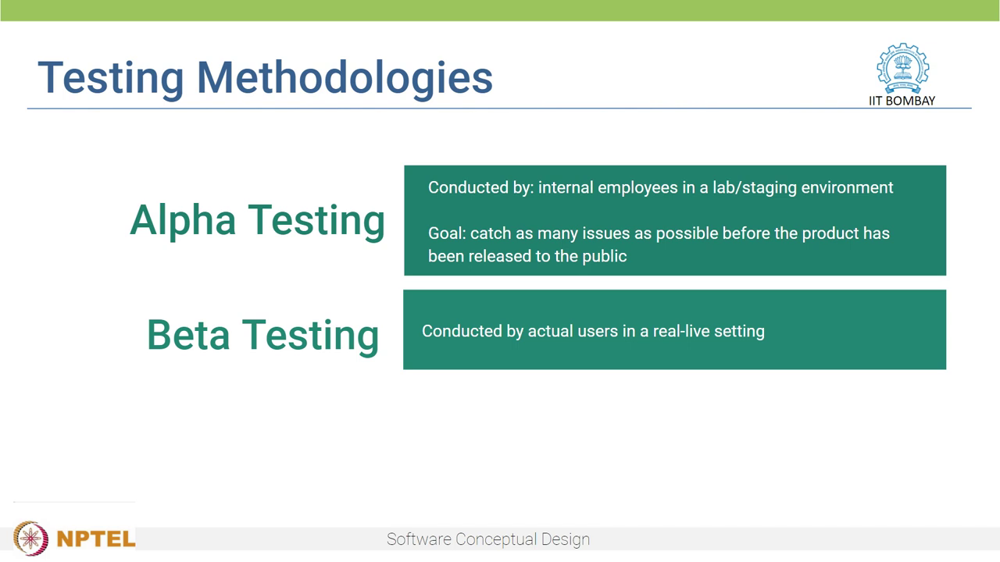

> **Trap (A1 Q7):** a travel app tested with a small group of *colleagues from other departments* who were not involved in development = **Alpha** (they are internal).

**Maintenance phase** (after the feature is rolled out)

1. **Monitor** what users are doing and how they use the software.
2. **Change the code** for upgrades/updates (fix missed conditions, UI issues in a specific browser).
3. **Add features**.

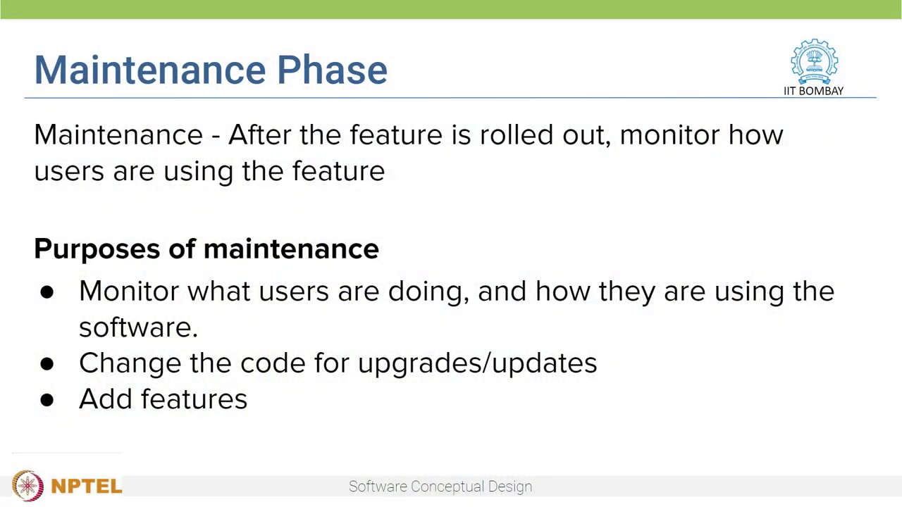

Example: Amazon Pay after release. Some conditions might have been missed → failures; or a UI issue in one browser. Found and fixed in maintenance.

## Lecture 6: Software development models

**The phases, in order**

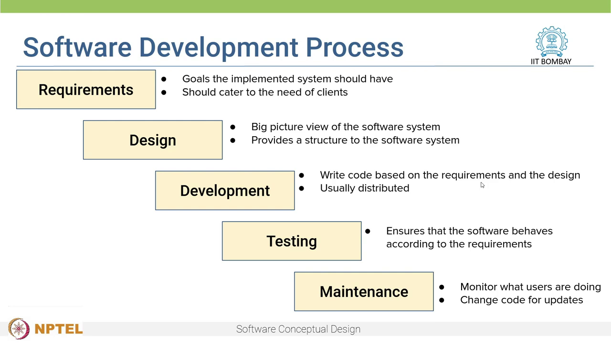

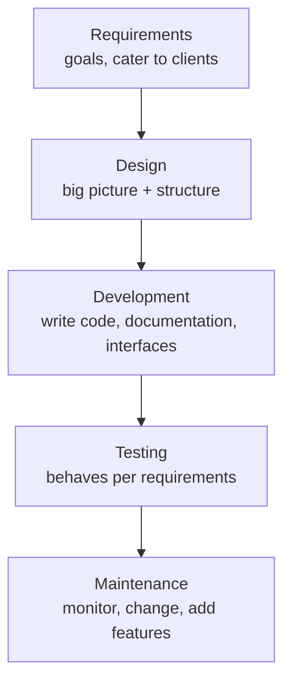

### Waterfall model
Phases occur **sequentially**: Requirements → Design → Development → Testing → Maintenance.

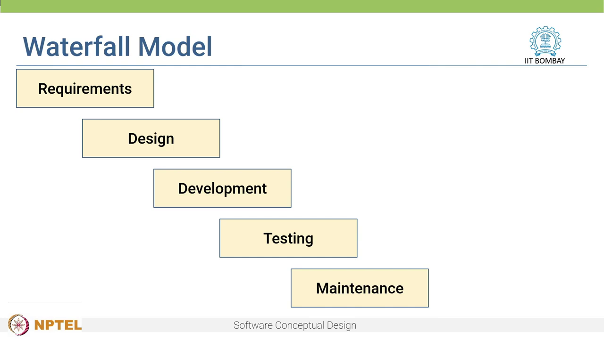

**Why it hurts** (lecture example): requirements 2 months + design 3 + development 4 + testing 3 = **12 months**. The client sees the software for the first time at release and says *"I don't like it!"* → back to the drawing board.

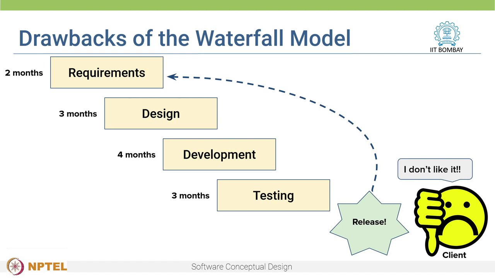

**Drawbacks**

1. **Increase in cost and time if changes are required later.** (the main one; A1 Q5)
2. **Clients may not know what they need**; requirements change over time.
3. **Designers may not know which design is most feasible/usable by clients.**

### V-model
A variation of waterfall: after implementation, the steps are **bent upwards** into a V.
- Left arm (down): Concept of operations → Requirements and architecture → Detailed design → **Implementation** (bottom).
- Right arm (up): Integration, test and verification → System verification and validation → Operation and maintenance.
- Test and verify **individual modules** and validate with the design; then verify and validate the **entire system** against the architecture.

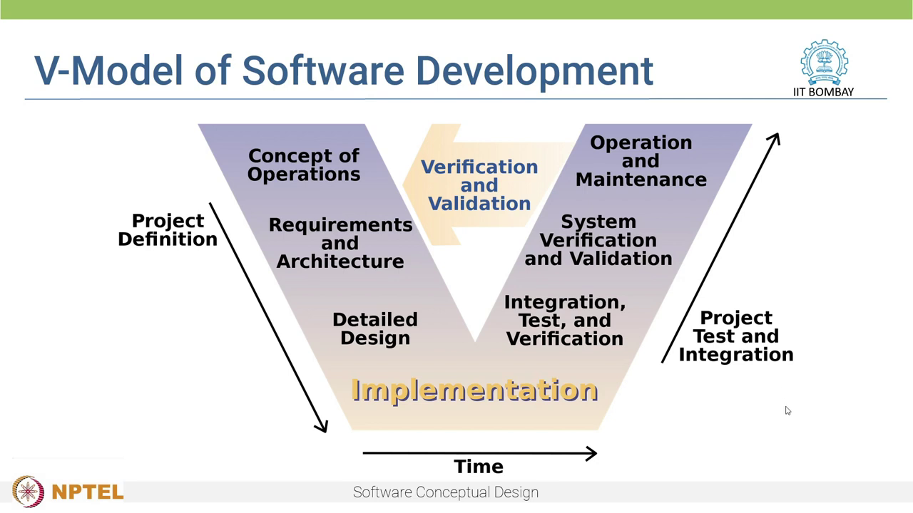

### Iterative development
Built in **multiple iterations**: plan and build features for key requirements → deploy → show to the client → get feedback → refine in the next iteration. Repeat until the product is complete. Cycle: Planning → Requirements → Analysis and design → Implementation → Testing → Evaluation → Deployment.

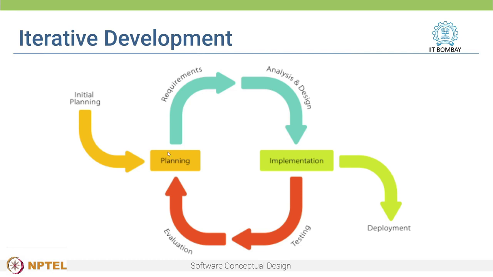

### Agile methodology
A popular **iterative** model: deliver in **small increments**; build **prototypes of key features** and release them quickly.
- **Frameworks:** Scrum, Kanban.
- **Practices:** sprints, test-driven development (TDD).
- Agile is an **umbrella term** for frameworks and practices based on the values and principles of the **agile philosophy** ("more than frameworks, practices").

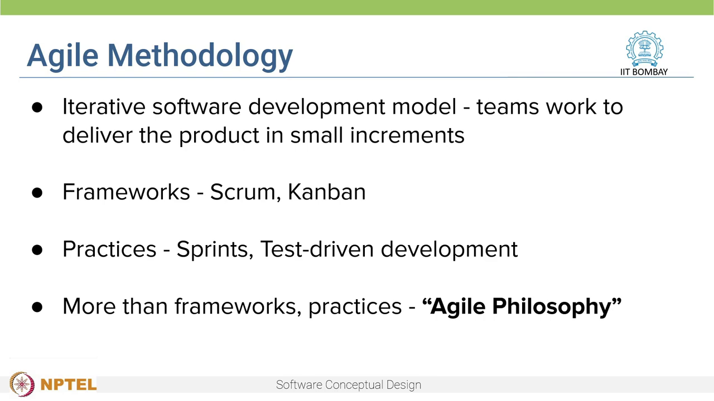

| Model | Shape | Strength | Weakness |
| --- | --- | --- | --- |
| Waterfall | Sequential, one pass | Simple, clear phases | Late client feedback; changes are costly |
| V-model | Waterfall bent upward | Each design level has a matching test level | Still sequential |
| Iterative | Repeated cycles | Early feedback, quick refinement | Needs planning per cycle |
| Agile | Small increments (Scrum, Kanban) | Frequent releases, adapts to change | Needs discipline and client involvement |

## Lecture 7: Comparing and contrasting software development

**Software vs. building construction**

| | Building | Software |
| --- | --- | --- |
| Components | **Tangible** (physical) | **Logical, abstract** |
| Adaptability | Hard to change once built | **Adaptable**; quickly changed by anyone on the team |
| Over time | **Static** | **Keeps changing** (Winamp → Saavn, Gaana) |
| Similar process | Blueprint first, requirement gathering, site visits / understanding end users, building scale models | Same steps in spirit |

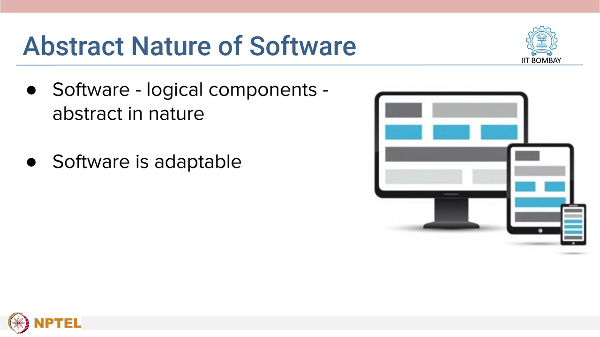
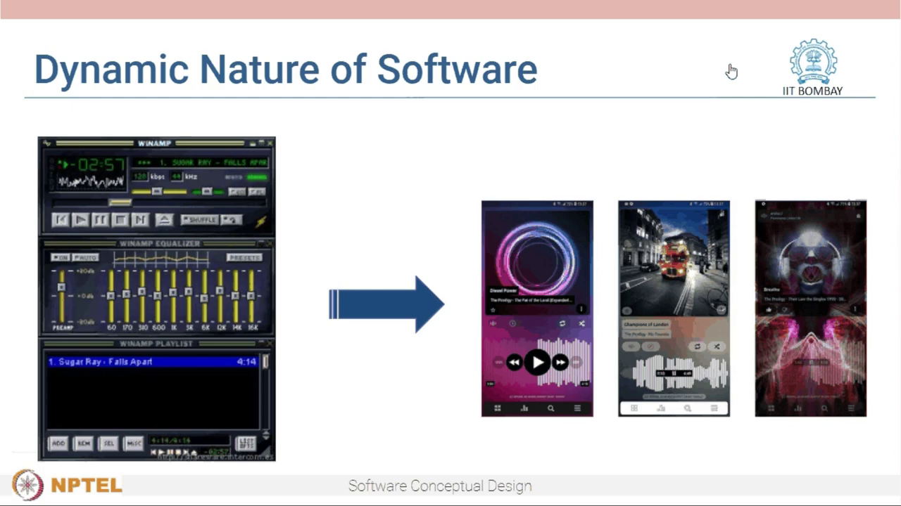

Thought experiment (LxI 1.2): how is software design similar to or different from building a **car**? (Same lessons: requirements, design before build, prototypes; difference: software is abstract, changeable, and has no manufacturing step.)

---

# WEEK 2 — Creating a Software Conceptual Design

## Lecture 8: Overview
This week: recap of components/modules, then methods to **begin creating a software conceptual design**.

## Lecture 9: Recap of Week 1
- Software is made of several components. Creation begins with **who will use it, for what purpose, and in what way**.
- Requirements → **design** (big picture) → **development** (code) → testing and maintenance.
- How these activities iterate is captured by the **software development process model** (waterfall, V-model, agile...). The team chooses a model that is appropriate and usually **adapts** it to their own processes and nature of software.

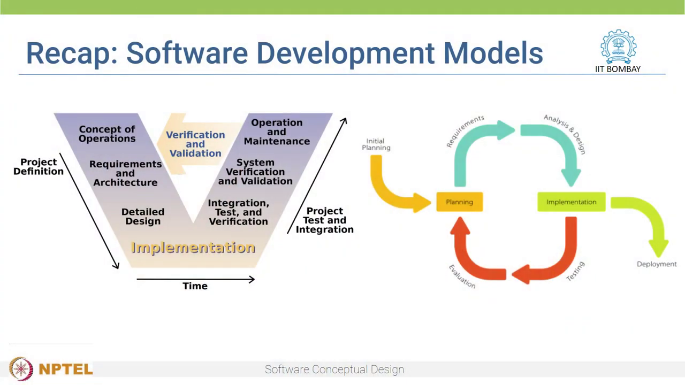

## Lecture 10: How to start creating a software conceptual design

**Running example: the mood-based music player.** It: automatically **detects mood**, **plays music according to the mood**, provides **secure authentication**, **remembers the user's choice** of music, and **recommends** music based on mood and the user's choice.

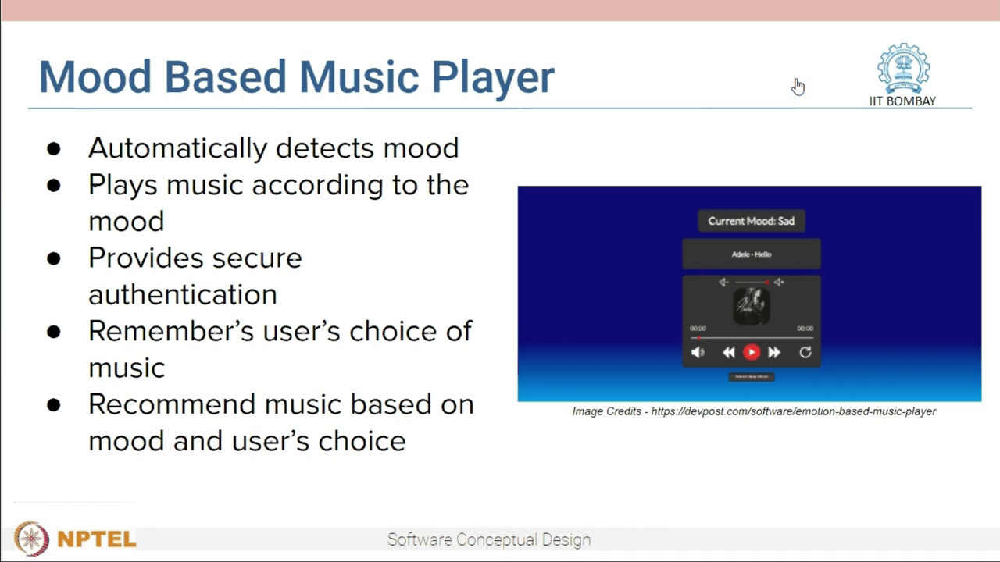

The phases/models are only a *framework*; they do not guide *how to think* while designing. Experienced designers:
- have worked on similar systems and use them as **reference points**;
- hold an **integrated view** of the system and continuously think about the **why, what and how** of the design.

### The why, what, how = Function, Structure, Behaviour

| | Question | Meaning | Mood-player examples |
| --- | --- | --- | --- |
| **Function (F)** | **Why** | **Features** of the solution; the purpose deliberated from the requirements | Mood detection, playlist creation, user authentication |
| **Structure (S)** | **What** | **Physical and logical components** needed to realise the functions | Emotion recognition camera, playlist creation algorithm, emotion tagging of songs |
| **Behaviour (B)** | **How** | **Interaction between structures** that achieves the function | Camera recognises emotion → gives it to the playlist generator → creates a playlist based on mood |

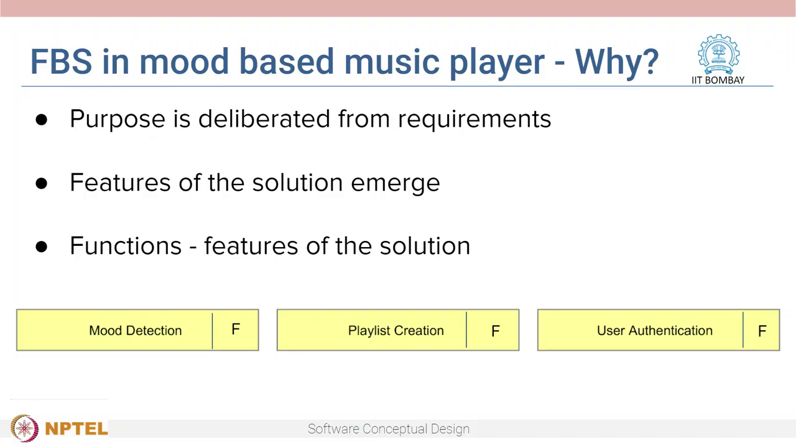
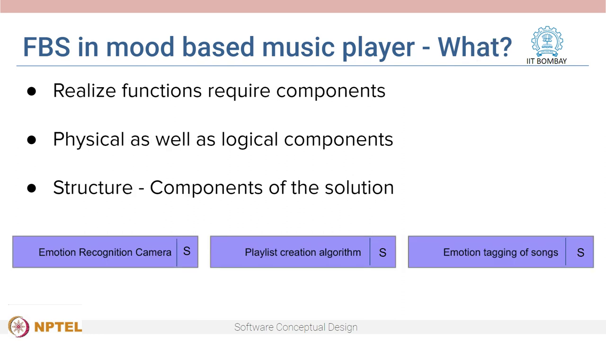
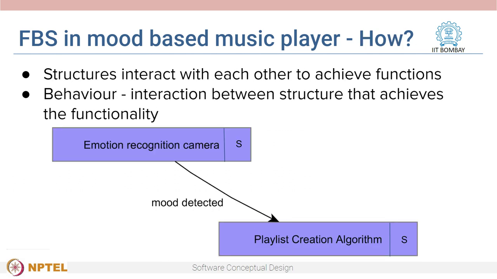
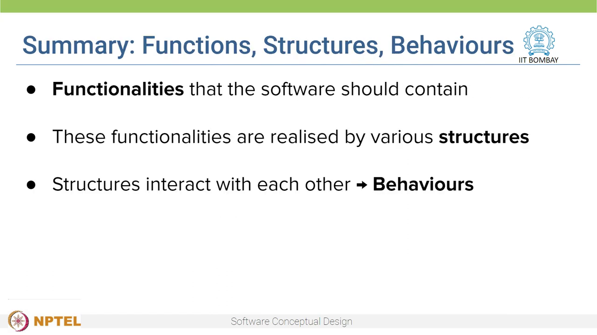

> **Behaviour = interaction between structures that results in achieving the purpose of the design.**
> (A2 Q7: the sentence *"the emotion camera captures the user emotion, provides it to the playlist generator which creates a playlist based on mood"* describes **interactions in the design solution** (behaviour) / the implementation of the mood-based feature. It is *not* a use case.)

## Lecture 11: Using the Function-Behaviour-Structure (FBS) design framework

### Why integrate F, B and S?

**If you do not integrate them → an incoherent, incomplete design with many solutions.** Example: if you only look at the function *mood detection*, you can create many solutions (webcam, voice-based detection, user-history-based detection...). It is **not decidable** which to choose.

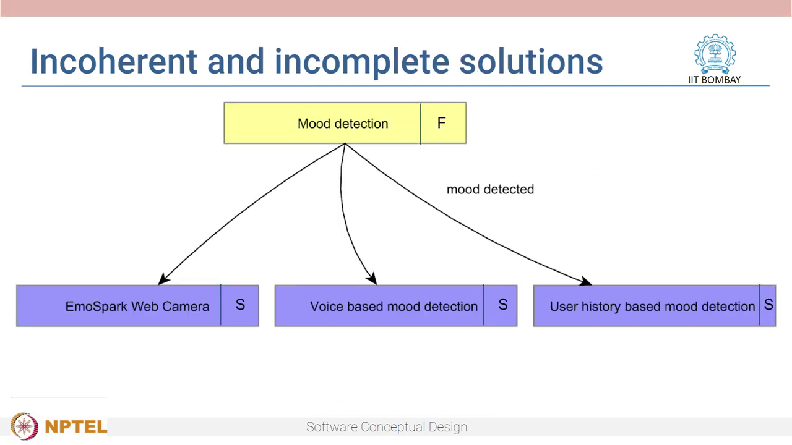

**Benefits of integrating**

1. Creates an **integrated (unified) view** of the design solution.
2. Helps **ensure the solution fulfils all the requirements**.
3. Gives a unified view for **communication within the team and with stakeholders**.
4. Helps **avoid getting stuck** while creating a design.

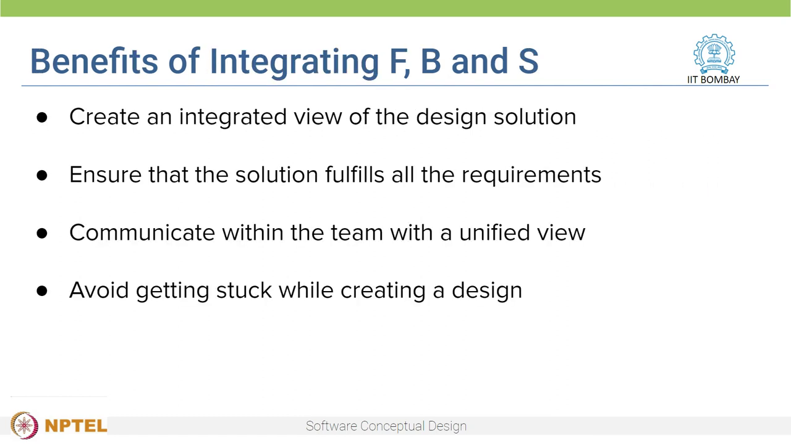

### How to integrate (the recipe)
1. **Start from a known solution.** E.g. there are cameras that detect mood → candidate **structures**. *Evaluate whether they apply to this problem and are adaptable.*
2. Think in terms of the **end user and the system** to generate **behaviours** (user places the camera → songs start; system fetches songs by mood).
3. **Map** all the structures that work together when a behaviour happens.
4. Identify how structures and behaviours **satisfy a requirement** (function).
5. Result: functions, structures, behaviours identified **and mapped**.

### The FBS graph
- **Nodes** = functions, structures, behaviours. **Links** connect them.
- You can start from **any** node (F, B or S) and move to the next as you identify and connect them.
- Colour convention in the slides: **yellow = F**, **blue/purple = S**, **red/pink = B**.

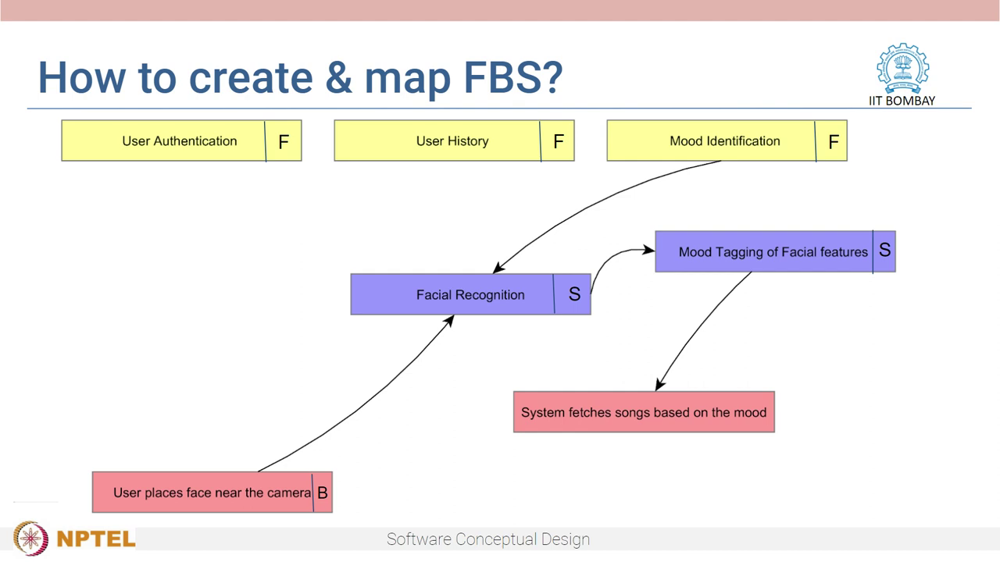

### Many FBS graphs are possible
- **Behaviour → Structure → Function** graph: behaviours mapped to structures, then to function (BSF).
- **Function → Structure → Behaviour** graph: functions broken down and mapped to structures, combined to different end-user behaviours (FSB).
- **There is NOT a single correct FBS graph**; there are many types/kinds for the same problem. (A2 Q3.)

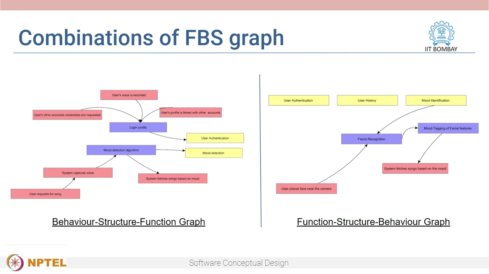

**How do I know my graph is good?** There is a **checklist of evaluation criteria** to self-evaluate it. **Think & Link** is the learning environment where you create and self-evaluate FBS graphs.

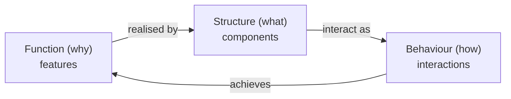

## Lecture 12: Creating conceptual designs using Think & Link

Think & Link is a web learning environment (IIT Bombay EdTech, `thinknlink.tech`). Register (username, email, password), log in. A **pedagogical agent** gives prompts throughout (the "Conceptual Design Assistant"). You have a **Notes** box. Tabs unlock as you complete each task.

**Phases**

| Phase | What you do |
| --- | --- |
| **Introduction** | Watch the intro video, read the design problem; explore the given **FBS graph** (via interactions); view the **UML diagram** corresponding to it; complete the **worksheet** (tasks 1-6). Saving answers unlocks the graph and later tabs. |
| **Induction** | Watch a video; state objectives and how you'll apply learnings in your design. **Explore *and edit* the graph**: add function, structure, behaviour nodes and connect them (agent prompts as you edit). Then **evaluate** the graph with the **evaluation wheel** (assign a category, give a reason). You may go back, edit, and re-evaluate. Phase ends when all parameters are completed. |
| **Ideation** | Answer planning questions; **write your own design problem**; **create an FBS graph from scratch**; evaluate it with the wheel; complete this for **two problems**. |
| (Iteration) | Present on the tab bar; greyed out in the walkthrough. |

> **Trap (A2 Q4):** the phase where you can **explore the graph and then edit it** by adding features available in Think & Link = **Induction phase** (not Introduction).

**Introduction worksheet tasks** (the six tasks seen in the lecture)

1. Identify and list function, structure and behaviour nodes from the graph.
2. True/false statements (with a reason), e.g. "automatic mood detection is a functionality of the player"; "the voice recognition algorithm is a logical component".
3. Describe in your own words what **function**, **structure** and **behaviour** mean.
4. List the **connector types** between nodes (F-S, S-B, F-B, S-S, B-B, ...).
5. Give concrete examples of **pairs** (F-S, S-B, F-B...) and **trios** (FSB, SBF, FBS...) from the graph.
6. Write **abstract sentences** explaining the relationships, e.g. "Function is implemented by Structure which gets utilised during user Behaviour".

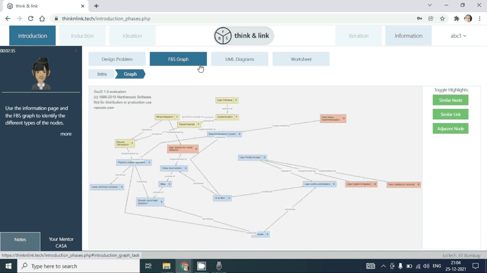

**UML from the FBS graph** (Think & Link also generates a UML diagram, e.g. a component diagram, from the graph):

1. For every **structure node**, create a **component** named after it.
2. Ensure the **hierarchy and relationships** between structure nodes are reflected in the component diagram.
3. If a component does **not implement a function**, check whether it is required.
4. For every F-B-S link (regardless of direction), ensure the corresponding interface/relationship exists in the component diagram.

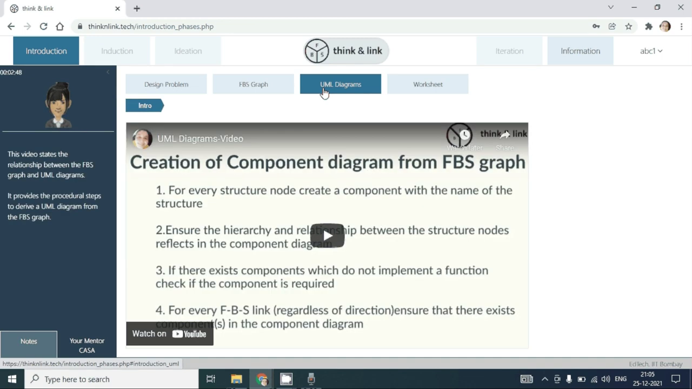

### The evaluation wheel (graph self-evaluation criteria)

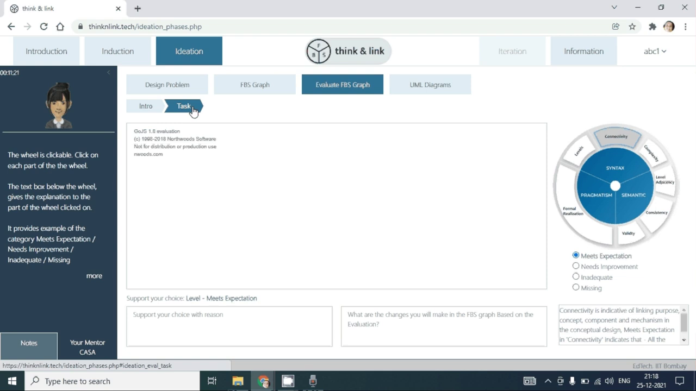

Each slice is rated **Meets Expectation / Needs Improvement / Inadequate / Missing**, with a written reason and the changes you will make.

| Criterion | Meaning (as tested in the assignments) |
| --- | --- |
| **Complexity** | Indicative of the **number of nodes in each category** (F, B, S) |
| **Connectivity** | Indicative of the **interconnected F, S, B nodes** (linking purpose, concept, component and mechanism) |
| **Formal realisation** | The FBS graph **converts to the corresponding UML diagrams** |
| **Level adjacency** | Nodes should link to nodes of the adjacent level of detail (not skip levels) *(name only is tested; this reading is the usual one)* |
| **Validity / Consistency / Levels** | Appear on the wheel; explained in Think & Link when you click the slice |

> **Trap (A2 Q5):** "formal realisation" does **not** mean *formally correct* or *usable in formal documents*. It means the graph can be **translated into UML**.

## Lecture 13: Week 2 summary
- Software conceptual design = creating a **design description** represented **graphically, numerically or textually**.
- Technique: **Function-Behaviour-Structure** framework. Tool: **Think & Link**.

---

# WEEK 3 — Comprehending and Evaluating Software Designs

## Lecture 14: Overview
New representation: **UML (Unified Modelling Language)**: different diagram types for detailed designs. **VeriSIM** = learning environment for integrated understanding of UML diagrams. Finally: **evaluating a design by quality attributes**.

## Lecture 15: Software modelling

- **Modelling = creating an external, explicit representation of the system to be built.**
- Benefits: plan what to code; **communicate the design with a larger team**; an overview of the whole solution.
- The FBS graph is a model. **UML is another model.** They serve different purposes at **different levels of detail**.

| | **FBS** | **UML** |
| --- | --- | --- |
| Purpose | Create an **idea/concept** of the system | Go into **more detail** |
| Level | High-level overview | Multiple views, greater detail |

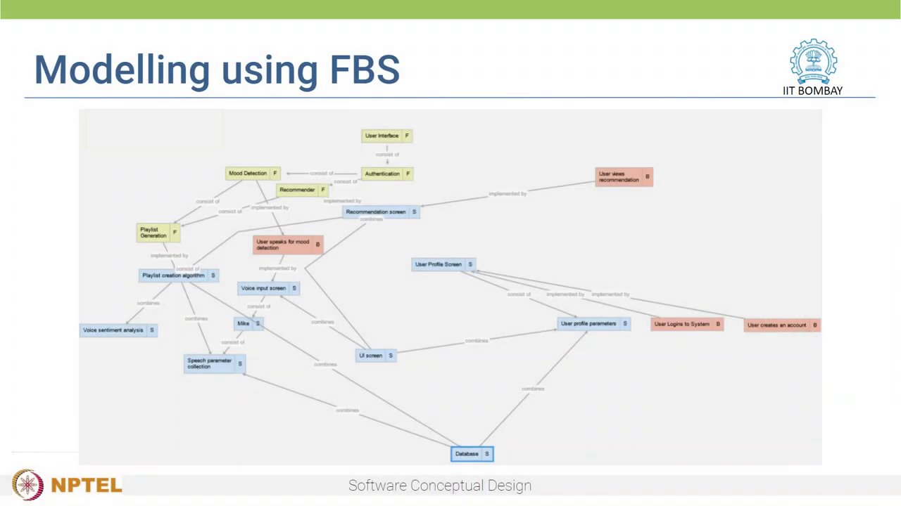
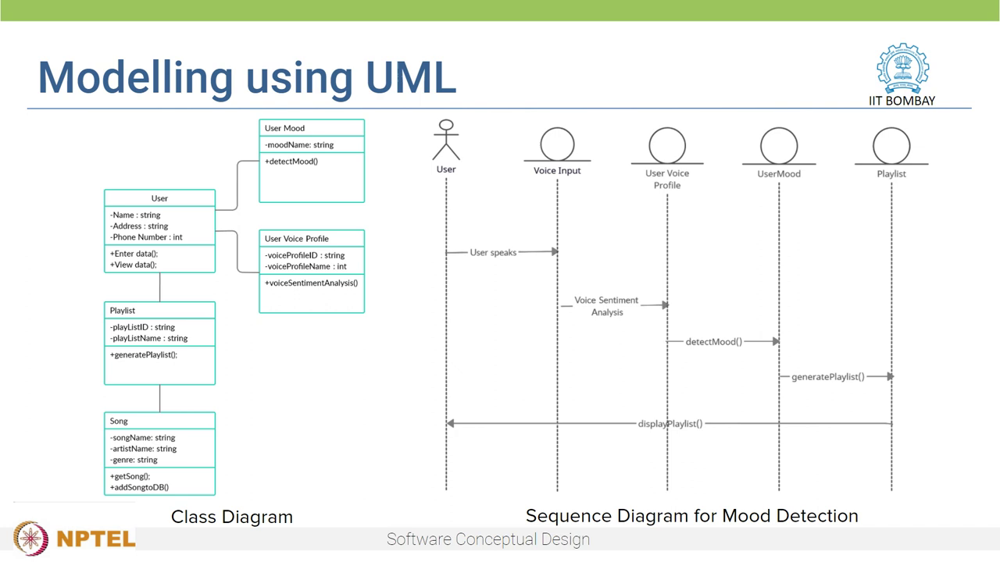

Example (slide): on the left an FBS graph of the mood player; a **part of it (mood detection) is detailed in a sequence diagram** on the right.

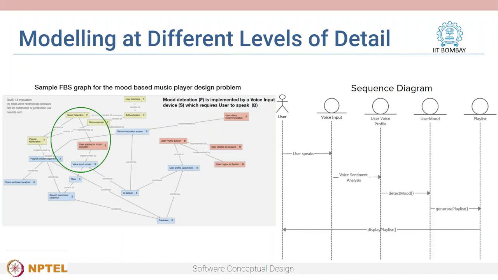

## Lecture 16: Unified Modelling Language (UML)

**Two important views**

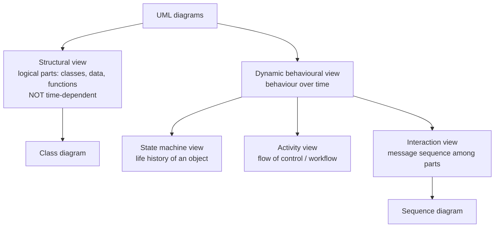

### Structural view → Class diagram
- Describes the **things in the system and their relationships**: classes, attributes, operations/methods, relationships among objects. **Static**, no time-dependent behaviour.
- **The main building block of object-oriented modelling.**
- A class is a box with **3 compartments:** **top = class name**, **middle = attributes (data members)**, **bottom = operations (member functions)**.
- Mood player classes: `User`, `User Voice Profile`, `Playlist`, `Song`, `User Mood`... e.g. `User Mood` has attribute `moodName : string` and operation `detectMood()`, which updates `moodName` based on the user and voice profile data.

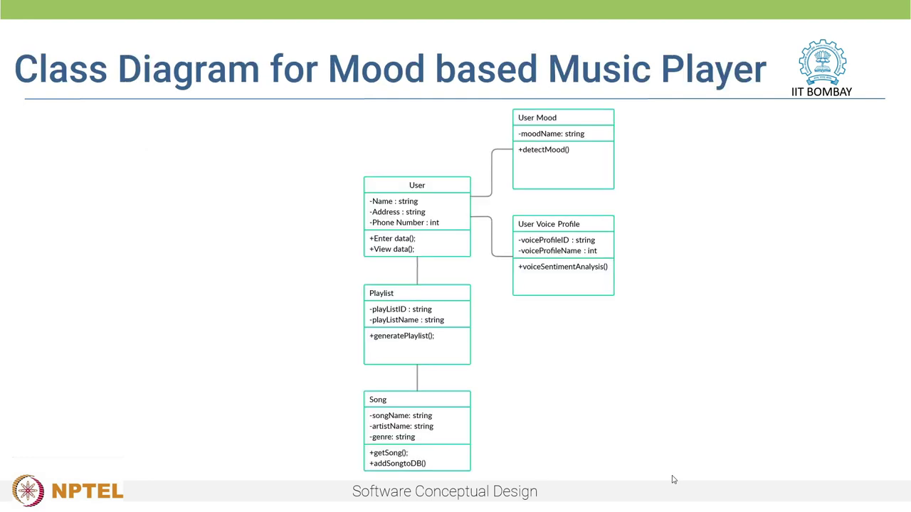

> **A3 Q6-8 (ATM):** the class diagram contains *both* data members **and** member functions (it is about behaviour too, as operations). `balance` in `Account` = a **data member**. `setOption()` in `ATM` = a **member function**.

### Dynamic behavioural view

| View | Models |
| --- | --- |
| **State machine** | Possible life histories / different states of an **object of a class** |
| **Activity** | **Flow of control** among computational activities in a calculation or workflow |
| **Interaction** | **Sequence of messages** exchanged among parts of a system; holistic view of control flow across many objects |

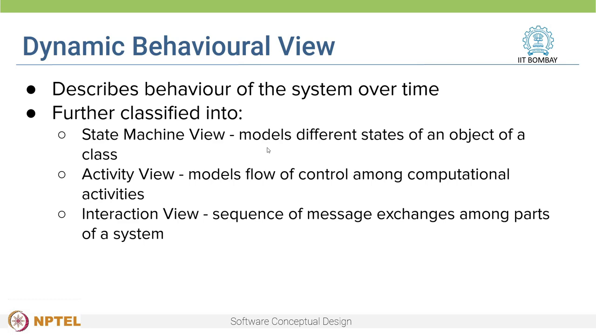

### Sequence diagram
- Describes the behaviour for a **requirement** (or sub-requirement). Objects/classes from the class diagram appear **across the top**, each with a vertical dashed **lifeline**.
- **Horizontal arrows = messages** exchanged, **in order of occurrence**. Messages can be **functions from the class diagram** (`detectMood`, `generatePlaylist`...).
- One sequence diagram per requirement; e.g. *mood detection* and *login*. Login includes alternatives: **credentials valid** → fetch previous user profile/playlist → "Login successful"; **else** → "Login unsuccessful".

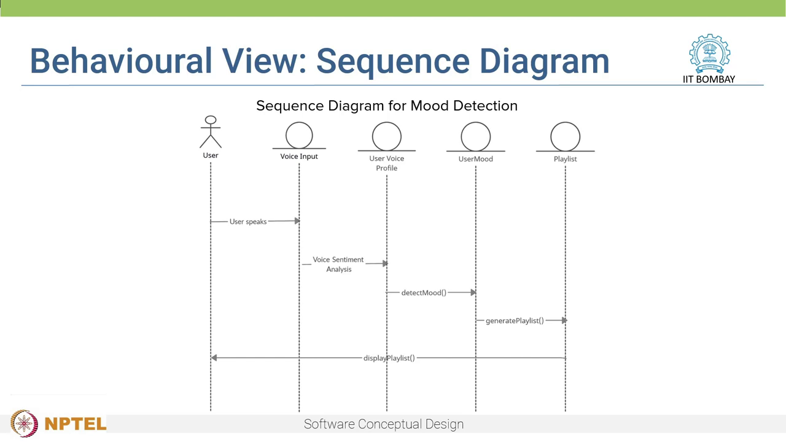
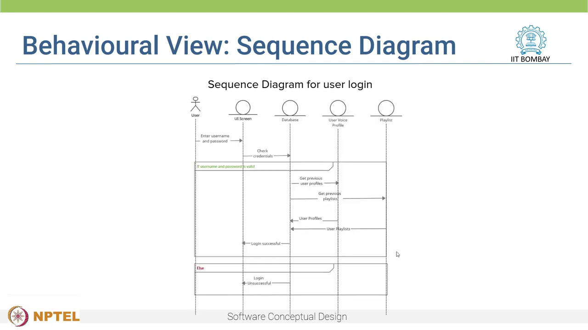

> **A3 Q9-10 (ATM):** `deposit()` returns **True/False**; if `checkPin()` returns **false** the message shown is **"Incorrect PIN"**.

There are other UML diagrams (state charts, communication, activity, component, deployment, use case, object, package, timing...). During design a **subset** is used to create the design model.

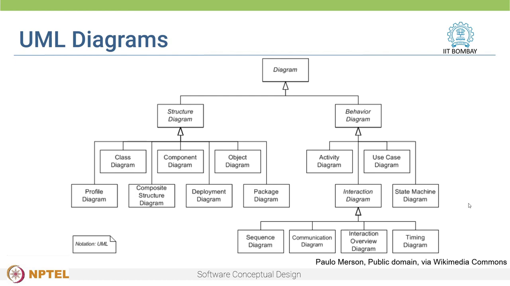

## Lecture 17: Software design comprehension

- **Design comprehension = trying to understand a given design.** An important workplace skill: developers usually work on **large existing complex systems** and add features, so they must explicitly comprehend designs.
- Example: integrate the mood-based player into an existing **Amazon Music** app (existing modules: inventory, payment gateway, video streaming...). First comprehend the existing subsystems, then design the new feature to integrate seamlessly.

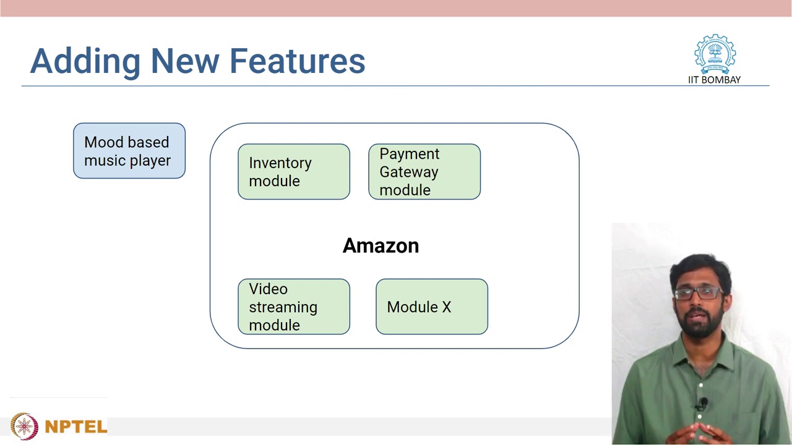

**Difficulties students face**

1. Not understanding **notations** (syntax) of the diagrams. (Easily learned with practice.)
2. Not seeing how **requirements** map to parts of the design (e.g. how does class `Song similarity` relate to a requirement?).
3. Not **connecting different diagrams**: each has a huge amount of detail (e.g. a sequence diagram uses objects from the class diagram).

**What an expert knows (4 kinds of knowledge)**

| Knowledge | Meaning | Example |
| --- | --- | --- |
| **Problem domain** | Context for which the design was developed | How a music player works |
| **Design diagram** | **Syntax and semantics** of the diagrams | Symbols in class / sequence diagrams |
| **Main goals** | Purpose of each diagram and its role; a diagram is composed of **sub-goals** | Login sequence: user input, what to do if login succeeds, if it fails |
| **Dynamic behaviours** | How **data members in the class diagram change** as the sequence diagram executes (how the system works in real time) | On successful login the user profile and playlists are fetched and values updated |

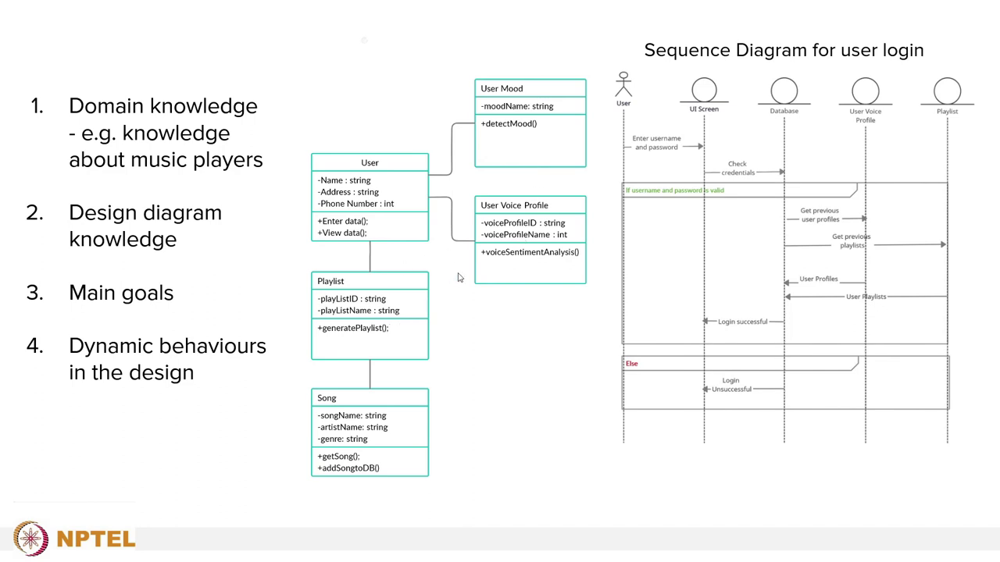

## Lecture 18: VeriSIM

- **VeriSIM = Verifying designs by Simulating scenarios.** Gives an **integrated understanding of the class and sequence diagrams**.
- Context: **automated door-locking system**. Requirements:
  1. If the passcode has not been set, the user can **register** and enter a passcode.
  2. **Lock** option + correct passcode → door **locks**; incorrect passcode → door remains **unlocked**.
  3. **Unlock** option + correct passcode → door **unlocks**; incorrect → door remains **locked**.
- Modelled with a **class diagram** (Door, Controller, Passcode) and several **sequence diagrams** (e.g. for unlocking).

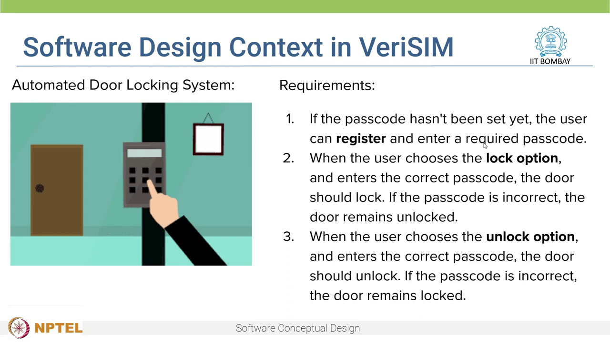
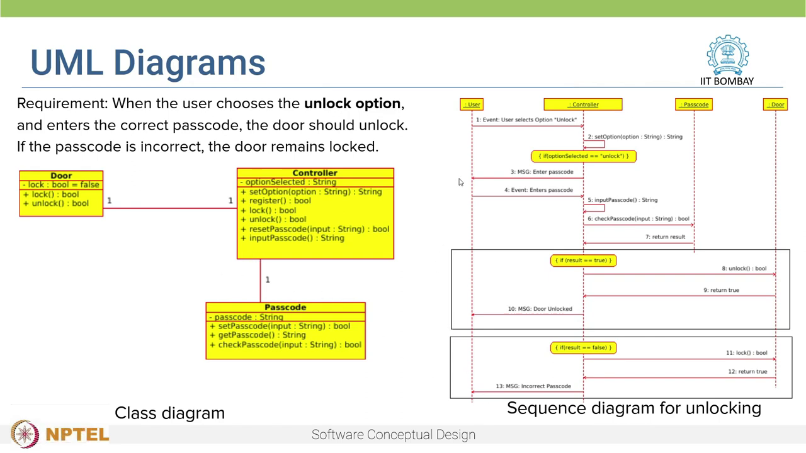

### Design tracing strategy
- **Construct a state diagram that models a given scenario.** (A3 Q2.)
- Example scenario: door initially locked, user selects **unlock** and enters the correct passcode → door unlocks.
- **Transitions = messages taken from the sequence diagram** (e.g. *set option to unlock (E1)*, *enter correct passcode (E2)*, *door unlocks (E3)*).
- **States = variables and their values taken from the class diagram** (`optionSelected`, `userInputPasscode`, `systemPasscode`, `lock`). Values change as you move through the transitions (e.g. `optionSelected` becomes `unlock`; finally `lock = false`).

### VeriSIM activities

The four challenges: **1 explore the model, 2 correct the model, 3 complete the model, 4 construct the model.** After each activity there are **evaluation** and **reflection** activities.

## Lecture 19: Software design quality perspectives

**Analogy: tiffin service** (breakfast, lunch, dinner every day). You are not satisfied if:

- food is late or **mixed up** (breakfast for lunch) → **Correctness**;
- you miss more than 3 meals a week → **Reliability**;
- the chef falls sick and there is no replacement → **Robustness**.

| Attribute | Definition | Software example |
| --- | --- | --- |
| **Correctness** | Extent to which a program **behaves according to its specification**. *A functional requirement.* | VeriSIM: check each scenario correctly satisfies all door-lock requirements |
| **Reliability** | Extent to which a program **behaves the same way over time in the same operating environment** | A wallet (Amazon Pay) must not crash often; withdrawals and deposits must work reliably |
| **Robustness** | Extent to which a program **can recover from errors or unexpected input** | Handles negative numbers, very large numbers, high traffic; handles payment failures |

| | Functional requirements | Non-functional requirements |
| --- | --- | --- |
| Describe | **What** the system should do (features) | **How** the system should behave |
| Examples | **Correctness** | **Reliability, robustness**, performance, portability, security |

> **A3 Q4/Q5 (Rido ride-sharing app):** *payment failures must be handled seamlessly* → **Robustness**. *App crashes often when many users book rides* → fails **Reliability**.
> Checking reliability/robustness is checking *how the system behaves*, **not** the system requirements.

## Lecture 20: Week 3 summary
- UML = another form of modelling; VeriSIM builds an integrated understanding of UML diagrams.
- **Functional vs non-functional requirements; examples: reliability and robustness.**
- It is good practice to **explicitly note down quality attributes and the design decisions based on them**, since they are often **implicit and not represented in the diagrams**.

---

# WEEK 4 — Tying It All Together

## Lecture 21: Overview
Recap of Weeks 1-3; how **FBS relates to the development-process phases**; how FBS and UML describe design at **different levels of abstraction**; videos on how software developers actually work in industry.

## Lecture 22: Software development process recap

- **Modularization** = dividing a software system into **multiple independent, co-working modules** capable of carrying out the desired functionalities; they form the basic **building blocks**. (A4 Q6)

- Software development begins with **understanding the needs of the end user**, then creating a plan, **verifying** it, implementing it in a programming language, **testing**, and **deploying** at the customer's end. It is a **systematic process of problem-solving**.
- Phases are broad and can be done **iteratively and in many different ways**, so developers must know and understand them.
- Compared with design in other domains (architecture): the **abstract and intangible** nature of software adds complexity, but there are **similarities in design processes** across domains (like steps in problem-solving).
- Weeks 2-3 built design **models** (FBS, UML). How do they map to the phases? → next lecture.

## Lecture 23: Mapping FBS to the software development process

Recap: **Function** = functionalities/features; **Structure** = physical and logical components; **Behaviour** = the mechanism by which structures interact to achieve the functionality.

**Mapping FBS design elements initiates software-engineering processes.** (Rational Unified Process.)

| Mapping of FBS elements | Software engineering process initiated |
| --- | --- |
| **Function ↔ Behaviour** | **Requirement definition** |
| **Structure ↔ Behaviour** | **Design analysis**, testing, implementation and requirements change |
| **Behaviour ↔ Behaviour** | **Evaluation, decomposition and refinement** |
| **Structure ↔ Structure** | **Evaluation, decomposition and refinement** |
| **Function ↔ Structure** | **Reusability and change in needs** |

> **A4 Q8:** "breaking down the implementation components" in a conceptual design = **Decomposition**.

## Lecture 24: Abstractions in modelling

- **Abstraction = a way of hiding details in the design at each stage of the design process.** (A4 Q7)
- **Level of detail = level of abstraction.**

| Level | Representation | What it does |
| --- | --- | --- |
| **High** | **FBS graph** (expands F, S, B of the solution) | Communicate key ideas; idea generation |
| **Medium** | **UML diagrams** | More detail; analysis and comprehension |
| **Low** (near code) | **Detailed UML models** | Close correspondence with implementation; code generation |

**From FBS to UML (Think & Link)**

- **Functions** in the FBS graph → expanded into **use cases**.
- **Structures** → **class diagrams**.
- **Behaviours** → described by **sequence diagrams**.

**Down to code:** detailed UML maps closely onto the implementation: *every class in a model maps onto one or more classes in the implementation code*. Tools **automatically generate code** from detailed UML. So, as we go across the abstraction levels we keep **adding implementation details**.

### Purposes of modelling (choose all that apply, A4 Q3)

| Purpose | Example model |
| --- | --- |
| **A vehicle for communication and idea generation** | **FBS graph** |
| **Analysis and comprehension** | **UML models** (as in VeriSIM) |
| **A blueprint for implementation** | **Detailed UML models** |

> **Which model when? (A4 Q4/Q5)** Communicate *key ideas first* → **FBS**. Give developers something to turn directly into code → **Detailed UML models**.

## Lecture 25: Summary
- Experts spend **a lot of time in the initial phases**: understanding the problem, creating models, **checking that models make sense in different scenarios**, *before* creating the solution.
- This course presented the steps and processes to do **before** you implement software: the process of **software conceptual design**.

---

# 2. Assignment answer key and the reason behind each answer

Use this section for last-minute revision. (✔ = accepted answer.)

## Week 1
| Q | Answer | Why |
| --- | --- | --- |
| 1. NOT a typical phase | **UI design** | Phases: requirements, design, development, testing, maintenance |
| 2. Clients can be | **All of the above** | External users, internal users, other software |
| 3. Purpose of the design phase | **Create a big-picture view of the system** | |
| 4. Collaboration in development | **Version control (Git)** | |
| 5. Waterfall drawback | **Hard to adapt to changing requirements** | Late changes cost time and money |
| 6. Bacteria-growth simulator, primary user | **Internal to the company** | The research lab itself |
| 7. Colleagues from other departments test the app | **Alpha testing** | Internal people, pre-release |
| 8. True statements | **Interface describes what functions can do without implementation detail; the implementing code can change** | |
| 9. Release blockchain feature to a few select users | **Testing** | (beta-style test) |
| 10. Outline modules and how they interact with existing ones | **Software design** | |
| 11. Gather blockchain info and RBI regulations | **Requirement specification** | |
| 12. Get user feedback, outline updates for next release | **Maintenance** | |

## Week 2
| Q | Answer | Why |
| --- | --- | --- |
| 1. Not integrating F, B, S | **Incoherent and potentially redundant design with multiple solutions** | |
| 2. Advantages of integrating | **All four** (unified view; meets requirements; team communication; avoids getting stuck) | |
| 3. How many possible FBS graphs | **Multiple, depending on design approach** | |
| 4. Explore then edit the graph | **Induction phase** | |
| 5. Formal realisation criterion | **FBS graph converts to the corresponding UML diagrams** | |
| 6. Main reason to link F, S, B | **Develop an integrated solution** | |
| 7. "Camera captures emotion, gives it to playlist generator..." | **Interactions in the design solution + implementation of the mood-based feature** (accepted; partial credit for one) | It describes behaviour |
| 8. Interconnected F, S, B nodes | **Connectivity** | |
| 9. Number of nodes per category | **Complexity** | |
| 10. Stage preceding development in traditional SDLC | **Design stage** | |

## Week 3
| Q | Answer | Why |
| --- | --- | --- |
| 1. Two main UML views | **Structural and dynamic behavioural** | |
| 2. Design tracing in VeriSIM | **Constructing a state diagram for a specific scenario** | |
| 3. Functional vs non-functional | **Functional = system's features; non-functional = its behaviour** | |
| 4. Rido payment failures | **Robustness** | |
| 5. Rido crashes under load | **Reliability** | |
| 6. Class diagram has only data members | **False** | It also has operations |
| 7. `balance` in `Account` | **Data member** | |
| 8. `setOption()` in `ATM` | **Member function** | |
| 9. `deposit()` returns | **True or False** | |
| 10. `checkPin()` returns false | **"Incorrect PIN"** | |

## Week 4
| Q | Answer | Why |
| --- | --- | --- |
| 1. Structures in FBS | **Physical and logical components** | |
| 2. FBS vs UML | **FBS = high-level overview; UML = more detailed views** | |
| 3. Purpose of modelling | **Communication/idea generation, analysis/comprehension, blueprint for implementation** (not "stakeholder requirements gathering") | |
| 4. Communicate key ideas first | **FBS** | |
| 5. Directly transform to code | **Detailed UML models** | |
| 6. Divide system into independent modules | **Modularization** | |
| 7. Hiding details at each design stage | **Abstraction** | |
| 8. Breaking down implementation components | **Decomposition** | |

---

# 3. Likely exam questions (self-test)

1. Which is *not* an SDLC phase? (UI design)
2. Who are the clients of software? (external users, internal users, other software)
3. State two drawbacks of the waterfall model; name two iterative/agile frameworks.
4. Difference between alpha and beta testing. Who conducts each?
5. What is an interface? Can the implementation behind it change?
6. Define F, S and B with an example from the mood-based player.
7. Why integrate F, B and S? What happens if you don't?
8. How many FBS graphs can exist for a problem?
9. Name the three phases of Think & Link; where do you edit the graph?
10. Complexity vs connectivity vs formal realisation.
11. Two views in UML; one diagram for each. What does a sequence diagram's arrow denote?
12. What does VeriSIM stand for? What is design tracing?
13. Correctness vs reliability vs robustness. Which are functional/non-functional?
14. Define modularization, abstraction, decomposition.
15. Map FBS (high) → UML (medium) → detailed UML (low). What does each FBS element become in UML?
16. Purposes of modelling and the model best suited to each purpose.
17. Which FBS mapping initiates requirement definition? (Function ↔ Behaviour)

---

*Sources: course book `Software conceptual design.pdf` (lecture transcripts and slides, IIT Bombay / NPTEL) and the Week 1-4 NPTEL assignments. Where a detail was not stated in the lectures (the wording of "level adjacency") it is marked as such.*
